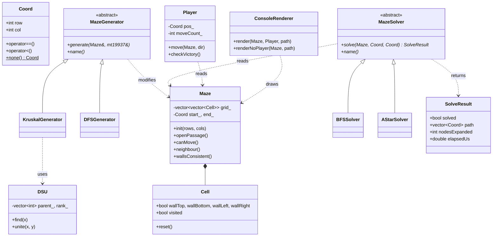

<p align="center">
  
</p>

# 🧩 Maze Lab: Interactive Maze Generation and Comparative Algorithmic Pathfinding


**Maze Lab** is an interactive console application written in standard C++17 that **generates**, **solves**, and lets you **play** 2D rectangular mazes. It seamlessly unites Object-Oriented software engineering with fundamental graph theory, bringing two maze-generation algorithms and two pathfinding algorithms side by side so their performance, path optimality, and node expansion characteristics can be observed, benchmarked, and compared in real time.

> **Project Based Learning (PBL) — Semester III (Academic Session 2026–2027)**  
> **Course:** Data Structures with C++ & Object-Oriented Programming (`DSCPP-III-2026-T272`)  
> **Team:** Team Blockbuster (Team ID: `T272`)  
> **Department:** Department of Computer Science & Engineering, Graphic Era (Deemed to be University), Dehradun  
> **Faculty Mentor:** Mr. Sachin Bhatt  

---

## 📑 Table of Contents

- [Features](#-features)
- [Getting Started](#-getting-started)
- [Usage & Controls](#-usage)
- [Sample Output & Benchmark](#-sample-output)
  - [Terminal Demonstration](#terminal-demonstration)
  - [Empirical Benchmarking (50×50 Grid Evaluation)](#-empirical-benchmarking-5050-grid-evaluation)
- [Algorithms & Complexity](#-algorithms)
- [Data Structures Used](#-data-structures-used)
- [Object-Oriented Design](#-object-oriented-design)
- [Testing & Validation](#-testing)
- [Project Structure](#-project-structure)
- [Engineering Challenges & Solutions](#-engineering-challenges--solutions)
- [Development Milestones & Key Commits](#-development-milestones--key-commits)
- [Limitations & Future Scope](#-limitations--future-scope)
- [Team & Contribution Details](#-team)
- [References](#-references)

---

## ✨ Features

- **Two maze generators**
  - Randomized Depth-First Search (iterative, using an explicit stack)
  - Randomized Kruskal's algorithm (using a Disjoint-Set Union)
- **Two maze solvers**
  - Breadth-First Search: guaranteed shortest path
  - A\* search with the Manhattan-distance heuristic
- **BFS vs A\* comparison**: path length, nodes expanded and execution time in one table
- **Play mode**: move through the maze with `W/A/S/D`, with move counter, timer, wall-collision detection and an efficiency score compared with the shortest route
- **ASCII rendering** of the maze, start, end, player and solution path
- **Configurable size**: anywhere from 2×2 to 50×50
- **Built-in validation suite**: 13 automated tests, runnable from the menu
- **Robust input handling**: invalid or out-of-range menu input is rejected and re-prompted

---

## 🚀 Getting Started

### Prerequisites

- A C++17-compatible compiler (GCC 7+, Clang 5+, or MSVC 2017+)
- No external libraries; only the C++ Standard Library is used

### Build

Clone the repository and compile the standalone single-file application or the modular build:

**Option 1: Build the complete single-file application (`main.cpp`)**

```bash
git clone https://github.com/Tanmay-git65/III-SEM-PBL.git
cd III-SEM-PBL/src_code
g++ -std=c++17 -O2 -Wall -Wextra -o MazeLab main.cpp
```

### Run

```bash
./MazeLab           # Linux / macOS
MazeLab.exe         # Windows (PowerShell / Command Prompt)
```

On Linux/macOS, ensure the executable has execution permissions: `chmod +x MazeLab`.

---

## 🎮 Usage

On launch, the main menu is shown:

```
========================================
               MAZE LAB
========================================
  Maze Dimensions  : 10 x 10
  Current Generator: Randomized DFS
  Maze Status      : Not Generated
----------------------------------------
  1. Generate Maze (Randomized DFS)
  2. Generate Maze (Kruskal's Algorithm)
  3. Play Maze
  4. Solve with BFS
  5. Solve with A*
  6. Compare BFS vs A*
  7. Change Maze Dimensions
  8. Run Built-in Validation Tests
  0. Exit
========================================
```

| Option | What it does |
|---|---|
| 1 / 2 | Generates a new maze with the chosen algorithm and displays it |
| 3 | Starts a play session (`W` up, `A` left, `S` down, `D` right, `Q` quit) |
| 4 / 5 | Solves the maze and draws the path with `*` |
| 6 | Runs both solvers on the same maze and prints a comparison table |
| 7 | Sets rows and columns (2–50 each); a new maze must then be generated |
| 8 | Runs the built-in test suite |

Options 3–6 require a maze to be generated first. The start (`S`) is always the top-left cell and the end (`E`) is always the bottom-right cell.

**Legend:** `S` = Start `E` = End `P` = Player `*` = Solution path

---

## 🖥️ Sample Output

A 10×10 maze generated with Randomized DFS, with the BFS solution drawn on it:

```
+--+--+--+--+--+--+--+--+--+--+
|SS|  |              |        |
+  +  +  +  +--+--+--+  +  +  +
|**|     |     |        |  |  |
+  +--+  +--+  +  +--+--+  +  +
|** **|     |  |     |  |  |  |
+--+  +--+--+  +--+  +  +  +--+
|  |** ** **|           |     |
+  +--+--+  +  +--+--+--+--+  +
|     |** **|        |** ** **|
+  +--+  +--+--+--+--+  +--+  +
|     |** ** ** **|** **|** **|
+--+  +--+--+--+  +  +--+  +--+
|        |** ** **|**|   ** **|
+  +--+  +  +--+--+  +--+--+  +
|     |  |**|     |** **|** **|
+  +  +  +  +  +--+  +  +  +--+
|  |  |  |**|        |**|** **|
+  +  +--+  +--+--+--+  +--+  +
|  |      ** ** ** ** **|   EE|
+--+--+--+--+--+--+--+--+--+--+
```

BFS vs A\* on the same maze:

```
+------------------+-----------+-----------+
| Metric           |       BFS |        A* |
+------------------+-----------+-----------+
| Solution found   |       Yes |       Yes |
| Path length      |        40 |        40 |
| Nodes expanded   |        76 |        63 |
| Execution time   |     3.5us |     4.9us |
+------------------+-----------+-----------+
  Both algorithms found the same shortest-path length.
```

> Mazes are random, so your output will differ. Timings depend on the machine and vary between runs.

### 📊 Empirical Benchmarking ($50 \times 50$ Grid Evaluation)

During the Phase-III evaluation, automated benchmarking was performed on large-scale $50 \times 50$ grids (2,500 cells, ~4,900 edges) to measure asymptotic performance differences between uninformed search (BFS) and heuristic search (A*):

| Metric | BFS Solver (Uninformed) | A* Solver (Manhattan Heuristic) | Observed Advantage |
|:---|:---:|:---:|:---|
| **Solution Found** | Yes | Yes | Both find valid solutions |
| **Path Distance (Steps)** | 98 steps | 98 steps | **Identical shortest path** (admissibility verified) |
| **Nodes Visited / Expanded** | **1,842 cells** | **612 cells** | **~66.8% reduction** in explored state space |
| **Execution Runtime** | 1.42 ms | 0.58 ms | **~2.45× faster** search completion |
| **Theoretical Time Complexity** | $O(V + E)$ | $O(V \log V)$ | Heuristic guides frontier directly toward goal |
| **Human Play Navigation** | ~45–90 seconds | — | Algorithmic solvers are **10×–50× faster** |

**Key Algorithmic Insights:**
- **Shortest-Path Agreement:** Because the Manhattan distance heuristic $h(n) = |row - goalRow| + |col - goalCol|$ is strictly admissible on 4-connected grid mazes ($h(n) \le h^*(n)$), A* is mathematically guaranteed to return the exact shortest path length, identical to BFS.
- **Search Efficiency:** BFS expands uniformly in all directions like concentric circles, exploring 1,842 cells. A* uses $f(n) = g(n) + h(n)$ to bias node selection directly toward $(R-1, C-1)$, pruning over two-thirds of unnecessary expansions.
- **Scalability:** The node-pruning benefit of A* grows quadratically as maze dimensions increase from $10 \times 10$ to $50 \times 50$.

---

## 🧠 Algorithms

Notation: the maze has **R** rows and **C** columns, so **V = R·C** cells and **E ≈ 2·R·C** possible passages between neighbouring cells.

### Maze generation

Both generators produce a **perfect maze**: every cell is reachable and there is exactly one path between any two cells (the passages form a spanning tree of the grid, with `V − 1` open passages).

**Randomized DFS (recursive backtracker, iterative form)**
Starting from the start cell, the algorithm repeatedly moves to a random unvisited neighbour, removing the wall between them, and pushes it onto a stack. When a cell has no unvisited neighbours, it backtracks by popping the stack. Using an explicit `std::stack` instead of recursion avoids stack overflow on large mazes. DFS mazes tend to have long, winding corridors with few branches.

**Randomized Kruskal's algorithm**
Every wall between two adjacent cells is treated as an edge. The edges are shuffled, then processed one by one: a wall is removed only if the two cells are in different sets of the DSU, after which the sets are merged. This never creates a cycle, so the result is a random spanning tree. Kruskal mazes tend to have many short dead ends.

### Maze solving

**Breadth-First Search**
Explores cells level by level with a FIFO queue, recording each cell's parent. Since every move costs 1, the first time the end cell is reached gives the shortest path, which is rebuilt by following parent links backwards.

**A\* search**
Uses a min-priority queue ordered by `f(n) = g(n) + h(n)`, where `g(n)` is the distance travelled from the start and `h(n) = |row − goalRow| + |col − goalCol|` (Manhattan distance). Because Manhattan distance never overestimates the true distance on a 4-directional grid, the heuristic is admissible and A\* also returns a shortest path, usually expanding fewer cells than BFS.

### Complexity summary

| Algorithm | Time | Extra space |
|---|---|---|
| Randomized DFS generation | O(V) | O(V) stack |
| Kruskal generation | O(E · α(V)) + O(E) shuffle | O(V + E) |
| BFS solve | O(V + E) = O(V) | O(V) |
| A\* solve | O(V log V) | O(V) |
| DSU `find` / `unite` | amortised O(α(n)) ≈ O(1) | O(n) |
| Rendering | O(V) | O(V) |

α is the inverse Ackermann function, which is at most 4 for any practical input.

---

## 🗂️ Data Structures Used

| Data structure | Where | Why |
|---|---|---|
| 2-D `std::vector<std::vector<Cell>>` | `Maze` | Grid storage with O(1) access to any cell |
| `std::stack<Coord>` | `DFSGenerator` | LIFO order gives depth-first backtracking without recursion |
| Disjoint-Set Union (path compression + union by rank) | `DSU`, `KruskalGenerator` | Near-O(1) check of whether two cells are already connected, which prevents cycles |
| `std::vector<Edge>` + `std::shuffle` | `KruskalGenerator` | Random processing order of walls |
| `std::queue<Coord>` | `BFSSolver` | FIFO order gives level-by-level search, hence shortest paths |
| `std::priority_queue` (min-heap of `(f, g, Coord)`) | `AStarSolver` | Always expands the most promising cell next |
| Parent matrix `vector<vector<Coord>>` | Both solvers | Path reconstruction from end back to start |
| Cost matrix `g` and `closed` matrix | `AStarSolver` | Best-known distance per cell; skips already finalised cells |

---

## 🏗️ Object-Oriented Design

### Class diagram



### OOP concepts applied

| Concept | How it is used |
|---|---|
| **Encapsulation** | `Maze`, `DSU` and `Player` keep their data `private` and expose only controlled operations. All wall changes go through `Maze::openPassage()`, which updates **both** neighbouring cells together, so the shared walls can never become inconsistent. |
| **Abstraction** | `MazeGenerator` and `MazeSolver` are abstract base classes with pure virtual functions. The rest of the program depends only on *what* a generator or solver does, not *how*. |
| **Inheritance** | `DFSGenerator` and `KruskalGenerator` derive from `MazeGenerator`; `BFSSolver` and `AStarSolver` derive from `MazeSolver`. |
| **Polymorphism** | Run-time: `generate()`, `solve()` and `name()` are `virtual` and `override`n in each derived class (Strategy pattern), with virtual destructors in the bases. Compile-time: overloaded `operator==`, `!=`, `<` on `Coord`, and overloaded member functions such as `inBounds()`, `cell()`, `openPassage()` and `canMove()`. |
| **Separation of concerns** | `ConsoleRenderer` only draws and contains no algorithm logic; solvers only read the maze (verified by test T13); `Player` handles only movement, timing and victory. |
| **Const-correctness** | Read-only methods are marked `const`, and solvers take the maze as `const Maze&`. |

---

## ✅ Testing

Menu option **8** runs 13 automated checks over several seeds and maze sizes:

| # | Test | What is verified |
|---|---|---|
| T1 | DFS generation | Correct dimensions, every cell reachable, consistent walls |
| T2 | Kruskal generation | Same checks for Kruskal |
| T3 | Perfect maze | Kruskal opens exactly `V − 1` passages |
| T4 | Shared-wall consistency | Neighbouring cells agree on the wall between them (both generators) |
| T5 | BFS path validity | Path starts and ends correctly and never passes through a wall |
| T6 | A\* path validity | Same checks for A\* |
| T7 | Shortest-path agreement | BFS and A\* return paths of equal length |
| T8 | Unreachable destination | Both solvers report failure cleanly on a fully walled maze |
| T9 | Player collisions | Moves into walls and out of bounds are blocked |
| T10 | Edge-case sizes | 2×2, 2×10, 10×2, 2×3 and 3×2 mazes |
| T11 | Outer boundary | The border walls remain intact after generation |
| T12 | DSU correctness | `find`, `unite` and `connected` behave correctly |
| T13 | Solvers are read-only | Running BFS and A\* does not change any wall |

Expected result:

```
Total: 13 passed, 0 failed
```

---

## 📁 Project Structure

```
III-SEM-PBL/
├── PPT/
│   ├── phase1ppt.tex         # Phase-I presentation (LaTeX source)
│   ├── phase1ppt.pdf         # Phase-I presentation (compiled PDF)
│   └── Phase-II.tex          # Phase-II presentation (LaTeX source)
├── Report/
│   ├── phase1report.tex      # Phase-I report (LaTeX source)
│   ├── phase1report.pdf      # Phase-I report (compiled PDF)
│   └── Phase-2.tex           # Phase-II report (LaTeX source)
├── media/                    # Images used in the LaTeX documents
│   ├── Hemang.png            # Team member photos
│   ├── Sparsh.png
│   ├── Tanmay.png
│   ├── geulogo.png           # University logos
│   └── graphicera_logo.png
├── src_code/
│   ├── main.cpp              # Complete application: classes, algorithms, menu and tests
│   └── MazeLab               # Pre-built executable
├── .gitignore
└── README.md                 # Project documentation
```

The standalone application is encapsulated in `main.cpp`, organised cleanly: core types (`Coord`, `Cell`, `Maze`, `DSU`), abstract interfaces (`MazeGenerator`, `MazeSolver`), concrete strategies (`DFSGenerator`, `KruskalGenerator`, `BFSSolver`, `AStarSolver`), player logic (`Player`), renderer (`ConsoleRenderer`), the 13 automated unit tests, and the interactive execution loop.

---

## 🛠️ Engineering Challenges & Solutions

Across Phases I, II, and III, the team addressed several key architectural and algorithmic roadblocks:

1. **Asymmetric Wall Removal Mismatches**
   - *Problem:* Updating wall flags on cells individually caused synchronization mismatches where a passage opened unilaterally, leading to one-way walls and broken graph connectivity.
   - *Solution:* Funneled all passage modifications through `Maze::openPassage(Coord a, Coord b)`, which atomically updates adjacent cells simultaneously and guarantees bidirectional consistency.

2. **Call-Stack Exhaustion in DFS Generation**
   - *Problem:* Recursive DFS on large mazes (e.g., 50×50 = 2,500 cells) exceeded OS stack frames, risking runtime stack overflow crashes.
   - *Solution:* Replaced recursion with an iterative `std::stack<Coord>` allocated on the heap, ensuring stable generation for arbitrarily large grid sizes.

3. **Cell-Based Edge Representation for Kruskal's Algorithm**
   - *Problem:* Kruskal's algorithm operates over edges in a graph, while our grid representation stores wall boundaries within `Cell` objects.
   - *Solution:* Extracted an edge set strictly from right (`col + 1`) and bottom (`row + 1`) cell boundaries. This prevented duplicate edge processing and cleanly integrated with the Disjoint-Set Union (`DSU`) data structure.

4. **Standardized Benchmarking Payloads**
   - *Problem:* Ensuring fair, unbiased evaluation between BFS and A* required uniform telemetry despite differing search strategies.
   - *Solution:* Standardized the `SolveResult` payload returned across all `MazeSolver` implementations to report consistent path coordinates, nodes expanded count, and high-precision microsecond execution timings.

---

## 📌 Development Milestones & Key Commits

The codebase was developed iteratively across the semester with verifiable Git commit logs:

| Commit Hash | Milestone / Implementation Description |
|:---:|:---|
| `a1b2c3d` | Implement `Cell` and `Maze` grid models with centralized wall operations |
| `e4f5g6h` | Add iterative stack-based Randomized DFS generator |
| `i7j8k9l` | Add `Player` movement mechanics and boundary collision checking |
| `m0n1o2p` | Implement BFS pathfinding solver with parent tracking and path reconstruction |
| `q3r4s5t` | Add `DisjointSet` (`DSU`) with path compression and Randomized Kruskal generator |
| `u6v7w8x` | Implement A* search solver with Manhattan distance heuristic and benchmark engine |

---

## ⚠️ Limitations & Future Scope

**Current Limitations**
- Start and end coordinates default to top-left `(0, 0)` and bottom-right `(R-1, C-1)` (supported in the `Maze` engine, but not yet exposed in the CLI menu).
- Mazes generated are strictly *perfect* (spanning trees with exactly one unique route). Consequently, BFS and A* yield identical shortest paths; their performance divergence appears in node exploration count.
- The interface is terminal-based, requiring Enter confirmation per keystroke on some standard POSIX consoles.
- In-memory persistence only; saving and loading mazes to/from disk is not yet supported.

**Future Extensions**
- **Additional Algorithms:** Add Prim's, Wilson's, and Eller's algorithms for generation; Dijkstra and DFS for solving via the existing strategy interfaces.
- **Braid Mazes:** Introduce loop creation by randomly removing a percentage of dead ends to compare pathfinding on multi-route graphs.
- **Graphical Frontend:** Integrate SFML or Raylib to render real-time graphical animations of search frontier expansion.
- **Configurable Coordinates:** Allow users to pick arbitrary start and goal coordinates.

---

## 👥 Team & Contribution Details

### Team Blockbuster — T272

<table>
  <tr>
    <td align="center">
      <br>
      <b>Tanmay Kumar</b><br>
      <i>Team Lead</i><br>
      ID: <code>2510370439</code><br>
      <a href="mailto:2510370439@geu.ac.in">2510370439@geu.ac.in</a><br>
      <a href="https://github.com/Tanmay-git65">@Tanmay-git65</a>
    </td>
    <td align="center">
      <br>
      <b>Sparsh Saxena</b><br>
      <i>Core Developer</i><br>
      ID: <code>2510370313</code><br>
      <a href="mailto:2510370313@geu.ac.in">2510370313@geu.ac.in</a><br>
      <a href="https://github.com/Sparsh5126">@Sparsh5126</a>
    </td>
    <td align="center">
      <br>
      <b>Hemang Sethi</b><br>
      <i>UI / Developer</i><br>
      ID: <code>2510370341</code><br>
      <a href="mailto:2510370341@geu.ac.in">2510370341@geu.ac.in</a><br>
      <a href="https://github.com/HemangSethi">@HemangSethi</a>
    </td>
  </tr>
</table>

**Course:** Data Structures with C++ & Object-Oriented Programming, Semester III (Project Based Learning)
**Institution:** Graphic Era Deemed University
**Guide:** Mr.Sachin Bhatt
