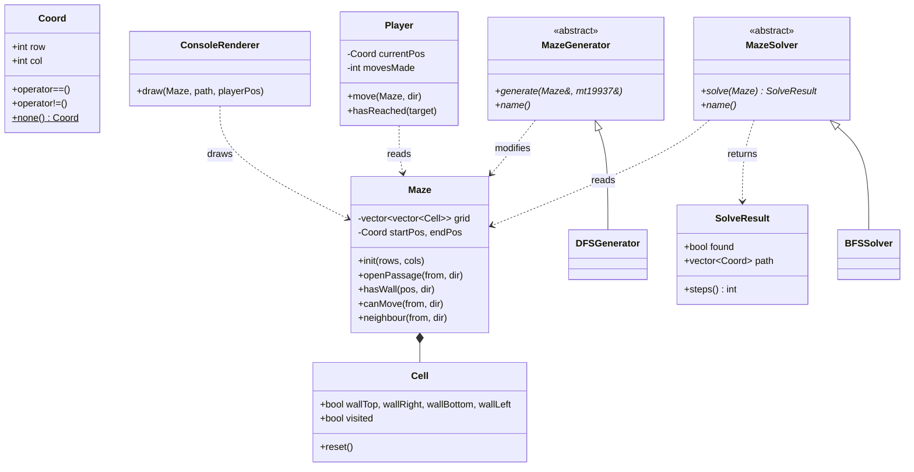

<p align="center">
  
</p>

# Maze Lab


**Maze Lab** is an interactive console application, written in C++17, that **generates** a random maze, lets you **play** through it, and **solves** it automatically. Each cell of the maze is treated as a vertex of a graph and each open passage as an edge, so maze generation and maze solving become graph algorithms.

> **Project Based Learning (PBL), Semester III (Academic Session 2026–2027)**  
> **Course:** Data Structures with C++ & Object-Oriented Programming (`DSCPP-III-2026-T272`)  
> **Team:** Team Blockbuster (Team ID: `T272`)  
> **Department:** Department of Computer Science & Engineering, Graphic Era (Deemed to be University), Dehradun  
> **Faculty Mentor:** Mr. Sachin Bhatt  

---

## Table of Contents

- [Features](#features)
- [Getting Started](#getting-started)
- [Usage](#usage)
- [Sample Output](#sample-output)
- [Algorithms](#algorithms)
- [Data Structures Used](#data-structures-used)
- [Object-Oriented Design](#object-oriented-design)
- [Project Structure](#project-structure)
- [Challenges and Solutions](#challenges-and-solutions)
- [Project Status](#project-status)
- [Limitations](#limitations)
- [Team](#team)

---

## Features

- **Maze generation** with Randomized Depth-First Search (iterative, using an explicit stack)
- **Maze solving** with Breadth-First Search, which always finds the shortest path; the path is drawn on the maze with `*`
- **Play mode**: move through the maze with `W/A/S/D`, with a move counter and a message when a wall blocks the move
- **ASCII rendering** of the maze, start, end, player and solution path
- **Configurable size**: anywhere from 2×2 to 50×50
- **Input validation**: invalid or out-of-range menu input is rejected and asked again

---

## Getting Started

### Prerequisites

- A C++17-compatible compiler (GCC 7+, Clang 5+, or MSVC 2017+)
- No external libraries; only the C++ Standard Library is used

### Build

```bash
git clone https://github.com/Tanmay-git65/III-SEM-PBL.git
cd III-SEM-PBL/src_code
g++ -std=c++17 -O2 -Wall -Wextra -o MazeLab main.cpp
```

### Run

```bash
./MazeLab           # Linux / macOS
MazeLab.exe         # Windows (when compiled with -o MazeLab.exe)
```

A pre-built `MazeLab` executable is included in `src_code/`. It was compiled on Linux (x86-64) and does not run on Windows or macOS; on those systems, build it with the command above. On Linux you may first need to make it executable with `chmod +x MazeLab`.

---

## Usage

On launch, the main menu is shown:

```
========== MAZE LAB (Phase II) ==========
Maze size: 10 x 10
Maze status: Not generated
1. Generate maze (Randomized DFS)
2. Play maze
3. Solve maze with BFS
4. Change maze size
0. Exit
```

| Option | What it does |
|---|---|
| 1 | Generates a new maze with Randomized DFS and displays it |
| 2 | Starts a play session (`W` up, `A` left, `S` down, `D` right, `Q` quit) |
| 3 | Solves the maze with BFS and draws the shortest path with `*` |
| 4 | Sets rows and columns (2–50 each); a new maze must then be generated |
| 0 | Exits the program |

Options 2 and 3 require a maze to be generated first. The start (`S`) is always the top-left cell and the end (`E`) is always the bottom-right cell. In play mode, type a key and press Enter for each move.

**Legend:** `S` = Start, `E` = End, `P` = Player, `*` = Solution path

---

## Sample Output

A 10×10 maze generated with Randomized DFS and solved with BFS (option 3):

```
BFS found a path of 38 steps.
+--+--+--+--+--+--+--+--+--+--+
|SS|        |      ** ** **|  |
+  +  +  +  +  +--+  +--+  +  +
|**|  |  |  |  |  |**|   **|  |
+  +--+  +--+  +  +  +--+  +  +
|** **|           |** **|** **|
+--+  +--+--+--+--+  +  +--+  +
|  |** ** ** ** **|  |**|** **|
+  +--+--+--+--+  +--+  +  +--+
|           |  |**|** **|**|  |
+--+  +--+  +  +  +  +--+  +  +
|     |        |** **|** **|  |
+  +--+--+--+--+--+--+  +--+  +
|                    |**|** **|
+  +--+--+--+  +--+  +  +  +  +
|  |        |     |  |** **|**|
+  +  +--+  +--+  +--+--+--+  +
|  |  |     |     |     |** **|
+  +  +  +--+  +--+  +  +  +--+
|     |     |        |   ** EE|
+--+--+--+--+--+--+--+--+--+--+
S = Start, E = End, P = Player, * = Path
```

> Mazes are random, so your output will differ.

---

## Algorithms

Notation: the maze has **R** rows and **C** columns, so **V = R·C** cells.

### Maze generation: Randomized DFS

1. All walls start closed. The start cell is marked visited and pushed onto a stack.
2. Look at the cell on top of the stack and collect its unvisited neighbours.
3. If there are none, pop the stack (backtrack).
4. Otherwise, pick one at random, open the wall between the two cells, mark it visited and push it.
5. Repeat until the stack is empty.

The result is a **perfect maze**: every cell is reachable and there is exactly one path between any two cells. Using an explicit `std::stack` instead of recursion avoids a stack overflow on large mazes.

### Maze solving: Breadth-First Search

1. Push the start cell onto a queue and record that its parent is itself.
2. Take the cell at the front of the queue. Stop if it is the end cell.
3. For every direction with no wall, if the neighbour has no parent yet, record the current cell as its parent and push it.
4. Rebuild the path by following parents back from the end cell to the start, then reverse it.

Every move costs 1 and BFS visits cells in order of distance from the start, so the first time it reaches the end cell it has found a shortest path.

### Complexity

| Algorithm | Time | Extra space |
|---|---|---|
| Randomized DFS generation | O(V) | O(V) stack |
| BFS solve | O(V) | O(V) queue and parent matrix |
| Rendering | O(V) | O(V) |

Each cell has at most 4 neighbours, so the number of edges is O(V), and BFS's O(V + E) becomes O(V).

---

## Data Structures Used

| Data structure | Where | Why |
|---|---|---|
| 2-D `std::vector<std::vector<Cell>>` | `Maze` | Grid storage with O(1) access to any cell |
| `std::stack<Coord>` | `DFSGenerator` | LIFO order gives depth-first backtracking without recursion |
| `std::queue<Coord>` | `BFSSolver` | FIFO order gives level-by-level search, hence shortest paths |
| Parent matrix `vector<vector<Coord>>` | `BFSSolver` | Marks visited cells and stores the route back to the start |
| `enum Direction` | Whole program | Names the four directions (`Up`, `Right`, `Down`, `Left`) |

---

## Object-Oriented Design

### Class diagram



### OOP concepts applied

| Concept | How it is used |
|---|---|
| **Encapsulation** | `Maze` and `Player` keep their data `private` and expose only controlled operations. All wall changes go through `Maze::openPassage()`, which updates **both** neighbouring cells together. |
| **Abstraction** | `MazeGenerator` and `MazeSolver` are abstract base classes with pure virtual functions. |
| **Inheritance** | `DFSGenerator` derives from `MazeGenerator`; `BFSSolver` derives from `MazeSolver`. |
| **Runtime polymorphism** | `generateAndShow()` takes a `MazeGenerator&` and `solveAndShow()` takes a `MazeSolver&`. The virtual functions `generate()`, `solve()` and `name()` are resolved at run time to the derived class's version. Both base classes have virtual destructors. |
| **Compile-time polymorphism** | Overloaded `operator==` and `operator!=` on `Coord`; `const` and non-`const` overloads of `Maze::cell()`; default arguments in `ConsoleRenderer::draw()`. |
| **Exception handling** | `readNumber()` catches the exception that `std::stoi` throws on invalid input. |
| **Separation of concerns** | `ConsoleRenderer` only draws; the solver only reads the maze (`const Maze&`); `Player` only handles movement. |

---

## Project Structure

```
III-SEM-PBL/
├── PPT/
│   ├── phase1ppt.tex         # Phase-I presentation (LaTeX source)
│   ├── phase1ppt.pdf         # Phase-I presentation (compiled PDF)
│   └── Phase-II.tex          # Phase-II presentation (LaTeX source)
├── Report/
│   ├── phase1report.tex      # Phase-I report (LaTeX source)
│   ├── phase1report.pdf      # Phase-I report (compiled PDF)
│   └── Phase-2.tex           # Phase-II report (LaTeX source)
├── media/                    # Images used in the LaTeX documents
│   ├── Hemang.png            # Team member photos
│   ├── Sparsh.png
│   ├── Tanmay.png
│   ├── geulogo.png           # University logos
│   └── graphicera_logo.png
├── src_code/
│   ├── main.cpp              # Complete Phase-II application
│   └── MazeLab               # Pre-built executable (Linux x86-64)
├── .gitignore
└── README.md                 # Project documentation
```

`main.cpp` is organised in this order: core types (`Direction`, `Coord`, `Cell`, `Maze`, `SolveResult`), abstract interfaces (`MazeGenerator`, `MazeSolver`), `DFSGenerator`, `BFSSolver`, `Player`, `ConsoleRenderer`, input helpers, the play session, the menu loop and `main()`.

---

## Challenges and Solutions

1. **Keeping shared walls consistent**
   - *Problem:* Each wall belongs to two neighbouring cells. Updating the cells separately let a passage open from one side but stay closed from the other.
   - *Solution:* All wall changes go through `Maze::openPassage()`, which updates both cells in the same call.

2. **Stack overflow risk in DFS generation**
   - *Problem:* Recursive DFS can go as deep as one call per cell (2,500 calls on a 50×50 maze), which risks a stack overflow.
   - *Solution:* Replaced recursion with an iterative `std::stack<Coord>`, whose storage lives on the heap.

---

## Project Status

Phase II is complete: grid and wall logic, the generator and solver interfaces, Randomized DFS generation, BFS solving, player movement with wall collision, console rendering and the generate, play and solve loop.

Planned for Phase III:

- Randomized Kruskal's generator using a Disjoint-Set Union
- A\* solver with the Manhattan-distance heuristic
- Metrics (path length, cells expanded, execution time) and a BFS vs A\* comparison
- Automated test suite

---

## Limitations

- Start and end are fixed at the top-left and bottom-right corners.
- The interface is text-only, and each move in play mode must be followed by Enter.
- Mazes cannot be saved or loaded.

---

## Team

### Team Blockbuster (T272)

<table>
  <tr>
    <td align="center">
      <br>
      <b>Tanmay Kumar</b><br>
      <i>Team Lead</i><br>
      ID: <code>2510370439</code><br>
      <a href="mailto:2510370439@geu.ac.in">2510370439@geu.ac.in</a><br>
      <a href="https://github.com/Tanmay-git65">@Tanmay-git65</a>
    </td>
    <td align="center">
      <br>
      <b>Sparsh Saxena</b><br>
      <i>Core Developer</i><br>
      ID: <code>2510370313</code><br>
      <a href="mailto:2510370313@geu.ac.in">2510370313@geu.ac.in</a><br>
      <a href="https://github.com/Sparsh5126">@Sparsh5126</a>
    </td>
    <td align="center">
      <br>
      <b>Hemang Sethi</b><br>
      <i>UI / Testing</i><br>
      ID: <code>2510370341</code><br>
      <a href="mailto:2510370341@geu.ac.in">2510370341@geu.ac.in</a><br>
      <a href="https://github.com/HemangSethi">@hemangsethi4-collab</a>
    </td>
  </tr>
</table>

### Phase-II contributions

| Task | Team member |
|---|---|
| `Cell` and `Maze` classes (2-D grid, wall logic) | Tanmay Kumar |
| Abstract `MazeGenerator` and `MazeSolver` interfaces | Tanmay Kumar |
| Generate, play and solve execution loop | Sparsh Saxena |
| Iterative Randomized DFS generator | Sparsh Saxena |
| BFS solver with parent tracking | Sparsh Saxena |
| Player input handling and wall collision | Tanmay Kumar |
| Console rendering of maze, player and path | Hemang Sethi |

**Course:** Data Structures with C++ & Object-Oriented Programming, Semester III (Project Based Learning)  
**Institution:** Graphic Era (Deemed to be University), Dehradun  
**Guide:** Mr. Sachin Bhatt
