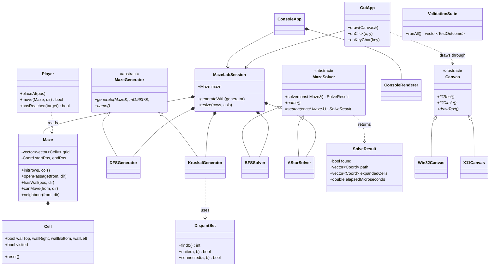

<p align="center">
  
</p>

# Maze Lab


**Maze Lab** is a C++17 application that **generates** random mazes with two algorithms, lets you **play** through them, **solves** them with two algorithms, and **compares** the solvers. Each cell of the maze is treated as a vertex of a graph and each open passage as an edge, so maze generation and maze solving become graph algorithms. It runs as a console menu or as a graphical window.

> **Project Based Learning (PBL), Semester III (Academic Session 2026–2027)**  
> **Course:** Data Structures with C++ & Object-Oriented Programming (`DSCPP-III-2026-T272`)  
> **Team:** Team Blockbuster (Team ID: `T272`)  
> **Department:** Department of Computer Science & Engineering, Graphic Era (Deemed to be University), Dehradun  
> **Faculty Mentor:** Mr. Sachin Bhatt  

---

## Table of Contents

- [Features](#features)
- [Getting Started](#getting-started)
- [Usage](#usage)
- [Sample Output](#sample-output)
- [Algorithms](#algorithms)
- [Results: BFS vs A\*](#results-bfs-vs-a)
- [Validation Tests](#validation-tests)
- [Data Structures Used](#data-structures-used)
- [Object-Oriented Design](#object-oriented-design)
- [Project Structure](#project-structure)
- [Customising the Program](#customising-the-program)
- [Challenges and Solutions](#challenges-and-solutions)
- [Project Status](#project-status)
- [Limitations](#limitations)
- [Team](#team)

---

## Features

- **Two maze generators**
  - Randomized Depth-First Search (iterative, using an explicit stack)
  - Randomized Kruskal's algorithm (using a Disjoint-Set Union with path compression and union by rank)
- **Two solvers**
  - Breadth-First Search
  - A\* with the Manhattan-distance heuristic
- **Solver comparison**: path length, cells expanded and execution time for BFS and A\* on the same maze
- **Play mode**: move from start to exit with `W/A/S/D` (or the arrow keys in the window); shows moves, time, shortest path and efficiency at the end
- **Graphical window** (Win32 on Windows, X11 on Linux) with buttons, keyboard shortcuts, colour overlays for the path and expanded cells, and a legend
- **Console interface** with ASCII rendering of the maze, start, end, player and solution path
- **13 automated validation tests**, runnable from the menu or the window
- **Benchmark mode**: 200 mazes of 50×50 per generator, averaged results for both solvers
- **Configurable size**: from 2×2 to 50×50
- **All colours, labels, symbols, keys and sizes in one file** (`settings.hpp`)
- No external libraries: only the C++ Standard Library and the operating system's own window API

---

## Getting Started

### Prerequisites

- A C++17-compatible compiler (GCC 7+, Clang 5+, or MSVC 2017+)
- Windows: nothing else (the window uses the built-in Win32 API)
- Linux: the X11 development library for the window (`libx11-dev` on Debian/Ubuntu)

### Build

```bash
git clone https://github.com/Tanmay-git65/III-SEM-PBL.git
cd III-SEM-PBL/src_code
```

**Windows (MinGW g++):**

```bash
g++ -std=c++17 -O2 -Wall -Wextra main.cpp -o maze.exe -lgdi32
```

**Linux with the window (X11, not yet tested by the team):**

```bash
g++ -std=c++17 -O2 -Wall -Wextra main.cpp -o MazeLab -lX11
```

**Any system, console only (no window):**

```bash
g++ -std=c++17 -O2 -Wall -Wextra -DMAZELAB_NO_GUI main.cpp -o MazeLab
```

`main.cpp` is the only `.cpp` file. All other files are headers included into it, so one command builds everything.

### Run

```bash
./maze.exe               # console menu (Windows; use ./MazeLab on Linux)
./maze.exe --gui         # open the graphical window directly
./maze.exe --benchmark   # print benchmark results and exit
```

---

## Usage

### Console menu

```
=============== MAZE LAB ===============
Maze size: 10 x 10
Generator: None
Maze status: Not generated
1. Generate maze (Randomized DFS)
2. Generate maze (Kruskal's Algorithm)
3. Play maze
4. Solve with BFS
5. Solve with A*
6. Compare BFS vs A*
7. Change maze size
8. Run validation tests
9. Open graphical window
0. Exit
```

| Option | What it does |
|---|---|
| 1 | Generates a new maze with Randomized DFS and displays it |
| 2 | Generates a new maze with Kruskal's algorithm and displays it |
| 3 | Starts a play session (`W` up, `A` left, `S` down, `D` right, `Q` quit; press Enter after each key) |
| 4 | Solves the maze with BFS and draws the path with `**` |
| 5 | Solves the maze with A\* and draws the path with `**` |
| 6 | Prints a table comparing BFS and A\* on the current maze |
| 7 | Sets rows and columns (2–50 each); a new maze must then be generated |
| 8 | Runs the 13 validation tests and prints PASS/FAIL for each |
| 9 | Opens the graphical window with the current maze |
| 0 | Exits the program |

Options 3–6 require a maze to be generated first. The start (`SS`) is always the top-left cell and the end (`EE`) is always the bottom-right cell.

**Legend:** `SS` = Start, `EE` = End, `PP` = Player, `**` = Solution path

### Graphical window

| Key / button | Action |
|---|---|
| `1` / `2` | Generate maze (DFS / Kruskal) |
| `3` | Start or stop play mode |
| Arrow keys or `W A S D` | Move the player; `Esc` or `Q` stops playing |
| `4` / `5` | Solve with BFS / A\* |
| `6` | Compare BFS and A\* (cells only BFS expanded are shown in a separate colour) |
| `7` | Run validation tests |
| `-` / `+` buttons | Change rows and columns in steps of 5 |

---

## Sample Output

A 10×10 maze generated with Randomized DFS (option 1):

```
+--+--+--+--+--+--+--+--+--+--+
|SS      |     |        |     |
+--+--+  +  +--+  +  +--+  +  +
|        |     |  |        |  |
+  +--+--+  +  +  +--+--+--+  +
|  |        |           |     |
+  +--+--+--+--+--+--+--+  +  +
|        |     |           |  |
+--+--+  +  +  +  +--+--+--+  +
|     |     |  |  |     |     |
+--+  +--+--+  +  +  +--+  +--+
|     |     |  |  |     |     |
+  +--+  +  +  +  +  +  +--+  +
|  |     |     |  |  |     |  |
+  +  +--+--+--+  +  +--+  +  +
|  |  |           |     |  |  |
+  +  +  +--+--+--+--+  +  +  +
|  |  |  |     |     |  |     |
+  +  +  +  +  +  +  +  +--+--+
|        |  |     |         EE|
+--+--+--+--+--+--+--+--+--+--+
SS = Start, EE = End, PP = Player, ** = Path
```

Comparing the solvers on that maze (option 6):

```
+------------------+------------+------------+
| Metric           |        BFS |         A* |
+------------------+------------+------------+
| Path found       |        Yes |        Yes |
| Path length      |         60 |         60 |
| Cells expanded   |         93 |         77 |
| Time             |    11.6 us |    15.9 us |
+------------------+------------+------------+
Both found a shortest path of the same length.
A* expanded 16 fewer cells than BFS.
```

> Mazes are random, so your output will differ. Times depend on the machine.

---

## Algorithms

Notation: the maze has **R** rows and **C** columns, so **V = R·C** cells. Each cell has at most 4 neighbours, so the number of possible passages **E** is O(V).

### Maze generation: Randomized DFS

1. All walls start closed. The start cell is marked visited and pushed onto a stack.
2. Look at the cell on top of the stack and collect its unvisited neighbours.
3. If there are none, pop the stack (backtrack).
4. Otherwise, pick one at random, open the wall between the two cells, mark it visited and push it.
5. Repeat until the stack is empty.

Produces long, winding corridors with few branches.

### Maze generation: Randomized Kruskal

1. All walls start closed. Every cell is its own set in a Disjoint-Set Union.
2. List every inner wall once (each cell's right and bottom wall) and shuffle the list.
3. For each wall: if the cells on its two sides are in different sets, open the wall and unite the sets. If they are already in the same set, keep the wall, since opening it would create a loop.

This is Kruskal's minimum spanning tree algorithm with a random edge order. Produces many short dead ends.

Both generators produce a **perfect maze**: a spanning tree of the grid, so every cell is reachable and there is exactly one path between any two cells. A tree with V vertices has exactly V − 1 edges, which the validation tests check.

### Maze solving: Breadth-First Search

1. Push the start cell onto a queue and record that its parent is itself.
2. Take the cell at the front of the queue. Stop if it is the end cell.
3. For every direction with no wall, if the neighbour has no parent yet, record the current cell as its parent and push it.
4. Rebuild the path by following parents back from the end cell to the start, then reverse it.

BFS visits cells in order of distance from the start, so the first time it reaches the end it has found a shortest path.

### Maze solving: A\*

A\* expands the cell with the smallest **f = g + h** first, using a priority queue:

- **g** = steps taken from the start
- **h** = Manhattan distance to the end, `|Δrow| + |Δcol|`

h never overestimates the real remaining distance (it is **admissible**), so A\* still returns a shortest path, while preferring cells that lead towards the end. Ties on f are broken in favour of the larger g. When a cheaper route to a cell is found, a new queue entry is pushed and stale entries are skipped when popped.

### Complexity

| Algorithm | Time | Extra space |
|---|---|---|
| Randomized DFS generation | O(V) | O(V) stack |
| Randomized Kruskal generation | O(V·α(V)): a linear-time shuffle of O(V) walls, then one `unite` per wall | O(V) |
| BFS solve | O(V) | O(V) queue and parent matrix |
| A\* solve | O(V log V) | O(V) priority queue and cost/parent matrices |
| Rendering | O(V) | O(V) |

α is the inverse Ackermann function, which is below 5 for any realistic input.

---

## Results: BFS vs A\*

From `--benchmark` (200 mazes of 50×50 per generator, seeds 0 to 199, built with `-O2`):

| Generator | Avg. path length | BFS cells expanded | A\* cells expanded | A\* saving | BFS time | A\* time | Length mismatches |
|---|---|---|---|---|---|---|---|
| Randomized DFS | 745.6 | 1477.5 | 1396.0 | 5.5% | 50.2 µs | 68.6 µs | 0 |
| Kruskal | 175.8 | 2135.9 | 1540.0 | 27.9% | 59.8 µs | 97.8 µs | 0 |

Observations:

- Both solvers always found paths of the same length (0 mismatches in 400 mazes), as expected for an admissible heuristic.
- A\* expanded fewer cells on both maze types, but far fewer on Kruskal mazes. DFS mazes have long winding corridors, so the straight-line Manhattan estimate is often misleading.
- A\* still took more time per maze. Each priority-queue operation costs O(log n) instead of O(1) for BFS's queue, and A\* maintains more data per cell. On mazes this size, the saving in expanded cells does not pay for that overhead.

Cell counts are identical on every run because the seeds are fixed. Times vary by machine.

---

## Validation Tests

Run with option 8 or the window's test button. Each check runs on mazes of size 2×2, 5×8, 10×10 and 25×40 with seeds 1, 7, 42 and 2026.

| Test | What it checks |
|---|---|
| T1, T2 | Every DFS / Kruskal maze is fully connected and its walls are consistent |
| T3 | Every maze has exactly V − 1 passages (no loops) |
| T4 | Shared walls agree on both sides |
| T5, T6 | BFS / A\* paths start at the start, end at the end, and every step is legal |
| T7 | BFS and A\* path lengths match |
| T8 | An unreachable exit is reported as "no path" |
| T9 | The player cannot move through walls or off the grid |
| T10 | Narrow and smallest sizes (2×2, 2×10, 10×2, 2×3, 3×2) work |
| T11 | The outer boundary is never opened |
| T12 | Disjoint-set `find`, `unite` and `connected` behave correctly |
| T13 | Solving does not change the maze |

The tests cover a fixed sample of mazes. Passing is strong evidence of correctness, not a proof for every possible maze.

---

## Data Structures Used

| Data structure | Where | Why |
|---|---|---|
| 2-D `std::vector<std::vector<Cell>>` | `Maze` | Grid storage with O(1) access to any cell |
| `std::stack<Coord>` | `DFSGenerator` | LIFO order gives depth-first backtracking without recursion |
| Disjoint-Set Union (`parent`, `rank` arrays) | `DisjointSet`, used by `KruskalGenerator` | Near-constant-time check whether two cells are already connected |
| `std::vector<WallEdge>` + `std::shuffle` | `KruskalGenerator` | Random order of walls to consider |
| `std::queue<Coord>` | `BFSSolver` | FIFO order gives level-by-level search, hence shortest paths |
| `std::priority_queue<OpenEntry>` (min-heap) | `AStarSolver` | Always expands the cell with the smallest f = g + h |
| Parent matrix `vector<vector<Coord>>` | `BFSSolver`, `AStarSolver` | Marks visited cells and stores the route back to the start |
| Cost and finalised matrices | `AStarSolver` | Best known g per cell, and which cells are done |
| `enum Direction` | Whole program | Names the four directions (`Up`, `Right`, `Down`, `Left`) |

---

## Object-Oriented Design

### Class diagram



### OOP concepts applied

| Concept | How it is used |
|---|---|
| **Encapsulation** | `Maze`, `Player` and `DisjointSet` keep their data `private`. All wall changes go through `Maze::openPassage()`, which updates **both** neighbouring cells together. |
| **Abstraction** | `MazeGenerator`, `MazeSolver` and `Canvas` are abstract base classes with pure virtual functions. |
| **Inheritance** | `DFSGenerator` and `KruskalGenerator` derive from `MazeGenerator`; `BFSSolver` and `AStarSolver` from `MazeSolver`; `Win32Canvas` and `X11Canvas` from `Canvas`. |
| **Runtime polymorphism** | The console and window take a `MazeGenerator&` or `MazeSolver&` and call `generate()`, `solve()` and `name()` without knowing the concrete class. `GuiApp` draws through a `Canvas&`, so the same drawing code runs on Windows and Linux. All base classes have virtual destructors. |
| **Template method** | `MazeSolver::solve()` times the search and calls the virtual `search()`, which each solver implements. |
| **Compile-time polymorphism** | Overloaded `operator==`, `operator!=` and `operator>`; `const` and non-`const` overloads of `Maze::cell()`; default arguments in `ConsoleRenderer::draw()`; a function template (`forEveryMaze`) in the test suite. |
| **Exception handling** | `readNumber()` catches the exception that `std::stoi` throws on invalid input. |
| **Separation of concerns** | Algorithms know nothing about the UI. `GuiApp` decides what to draw; `gui_window.hpp` only talks to the operating system. Solvers take the maze as `const Maze&`. All display values live in `settings.hpp`. |

---

## Project Structure

```
III-SEM-PBL/
├── PPT/
│   ├── phase1ppt.tex / .pdf      # Phase-I presentation
│   └── Phase-II.tex / .pdf       # Phase-II presentation
├── Report/
│   ├── phase1report.tex / .pdf   # Phase-I report
│   └── Phase-2.tex / .pdf        # Phase-II report
├── media/                        # Images used in the LaTeX documents
├── src_code/
│   ├── main.cpp                  # Entry point: console, --gui or --benchmark
│   ├── settings.hpp              # All colours, labels, symbols, keys and sizes
│   ├── maze.hpp                  # Direction, Coord, Cell, Maze
│   ├── disjoint_set.hpp          # Union-find with path compression and union by rank
│   ├── generators.hpp            # MazeGenerator, DFSGenerator, KruskalGenerator
│   ├── solvers.hpp               # MazeSolver, BFSSolver, AStarSolver, SolveResult
│   ├── player.hpp                # Player movement, move count and timer
│   ├── session.hpp               # MazeLabSession: shared state for console and window
│   ├── validation.hpp            # ValidationSuite: the 13 tests
│   ├── benchmark.hpp             # runBenchmark()
│   ├── console_ui.hpp            # ConsoleApp, ConsoleRenderer, input helpers
│   ├── gui_app.hpp               # Canvas, GuiApp: window layout, drawing, input handling
│   └── gui_window.hpp            # Win32 / X11 window, Canvas implementations
├── .gitignore
└── README.md
```

---

## Customising the Program

Every colour, label, console symbol, movement key, window size and maze-size limit is a named constant in [`src_code/settings.hpp`](src_code/settings.hpp). For example:

| To change | Edit |
|---|---|
| Window background colour | `BACKGROUND_COLOR` (`{red, green, blue}`, 0–255) |
| Wall / path / start / exit colour | `WALL_COLOR`, `PATH_COLOR`, `START_COLOR`, `EXIT_COLOR` |
| A button label | `BUTTON_DFS`, `BUTTON_PLAY`, ... |
| Console start symbol `SS` to `Start` | `START_MARK = "Start"` and `CONSOLE_CELL_WIDTH = 5` |
| Movement keys | `KEY_UP`, `KEY_LEFT`, `KEY_DOWN`, `KEY_RIGHT`, `KEY_QUIT` |
| Default / maximum maze size | `DEFAULT_ROWS`, `DEFAULT_COLS`, `MAX_SIZE` |

Rebuild after editing.

---

## Challenges and Solutions

1. **Keeping shared walls consistent**
   - *Problem:* Each wall belongs to two neighbouring cells. Updating the cells separately let a passage open from one side but stay closed from the other.
   - *Solution:* All wall changes go through `Maze::openPassage()`, which updates both cells in the same call. Test T4 checks this on every generated maze.

2. **Stack overflow risk in DFS generation**
   - *Problem:* Recursive DFS can go as deep as one call per cell (2,500 calls on a 50×50 maze), which risks a stack overflow.
   - *Solution:* Replaced recursion with an iterative `std::stack<Coord>`, whose storage lives on the heap.

3. **Detecting loops in Kruskal's generator**
   - *Problem:* Opening a wall between two cells that are already connected creates a loop, so the maze is no longer perfect.
   - *Solution:* A Disjoint-Set Union tracks connected regions; `unite()` returns `false` when the cells are already connected, and that wall stays closed. Test T3 checks that every maze has exactly V − 1 passages.

4. **One drawing code for two operating systems**
   - *Problem:* Windows and Linux have completely different window APIs.
   - *Solution:* `GuiApp` draws only through the abstract `Canvas` class. `Win32Canvas` and `X11Canvas` implement it, so only `gui_window.hpp` is platform-specific.

5. **Making presentation changes quick and safe**
   - *Problem:* Colours, labels and symbols were scattered across the UI code.
   - *Solution:* Moved every presentation value into `settings.hpp`, used by both the console and the window.

---

## Project Status

**Phase III is complete:**

- Randomized Kruskal's generator using a Disjoint-Set Union
- A\* solver with the Manhattan-distance heuristic
- Metrics (path length, cells expanded, execution time) and a BFS vs A\* comparison
- Automated test suite (13 tests)
- Benchmark mode
- Graphical window with play, solve and compare
- Centralised settings file

**Phase II (complete):** grid and wall logic, generator and solver interfaces, Randomized DFS generation, BFS solving, player movement with wall collision, console rendering and the generate, play and solve loop.

---

## Limitations

- Start and end are fixed at the top-left and bottom-right corners.
- In the console, each move in play mode must be followed by Enter.
- The window has a fixed size and is not DPI-aware, so with Windows display scaling it is enlarged and may not fit on smaller screens.
- Window text uses the ANSI Win32 functions, so non-English text is not supported.
- The Linux (X11) window has not been tested by the team.
- Mazes cannot be saved or loaded.

---

## Team

### Team Blockbuster (T272)

<table>
  <tr>
    <td align="center">
      <br>
      <b>Tanmay Kumar</b><br>
      <i>Team Lead</i><br>
      ID: <code>2510370439</code><br>
      <a href="mailto:2510370439@geu.ac.in">2510370439@geu.ac.in</a><br>
      <a href="https://github.com/Tanmay-git65">@Tanmay-git65</a>
    </td>
    <td align="center">
      <br>
      <b>Sparsh Saxena</b><br>
      <i>Core Developer</i><br>
      ID: <code>2510370313</code><br>
      <a href="mailto:2510370313@geu.ac.in">2510370313@geu.ac.in</a><br>
      <a href="https://github.com/Sparsh5126">@Sparsh5126</a>
    </td>
    <td align="center">
      <br>
      <b>Hemang Sethi</b><br>
      <i>UI / Testing</i><br>
      ID: <code>2510370341</code><br>
      <a href="mailto:2510370341@geu.ac.in">2510370341@geu.ac.in</a><br>
      <a href="https://github.com/HemangSethi">@hemangsethi4-collab</a>
    </td>
  </tr>
</table>

### Phase-III contributions

| Task | Team member |
|---|---|
| Randomized Kruskal generator and Disjoint-Set Union | Sparsh Saxena |
| A\* solver | Tanmay Kumar |
| Metrics and BFS vs A\* comparison | Sparsh Saxena |
| Validation test suite | Tanmay Kumar |
| Benchmark | Hemang Sethi |
| Graphical window (GUI) | Hemang Sethi |

### Phase-II contributions

| Task | Team member |
|---|---|
| `Cell` and `Maze` classes (2-D grid, wall logic) | Tanmay Kumar |
| Abstract `MazeGenerator` and `MazeSolver` interfaces | Tanmay Kumar |
| Generate, play and solve execution loop | Sparsh Saxena |
| Iterative Randomized DFS generator | Sparsh Saxena |
| BFS solver with parent tracking | Sparsh Saxena |
| Player input handling and wall collision | Tanmay Kumar |
| Console rendering of maze, player and path | Hemang Sethi |

**Course:** Data Structures with C++ & Object-Oriented Programming, Semester III (Project Based Learning)  
**Institution:** Graphic Era (Deemed to be University), Dehradun  
**Guide:** Mr. Sachin Bhatt
